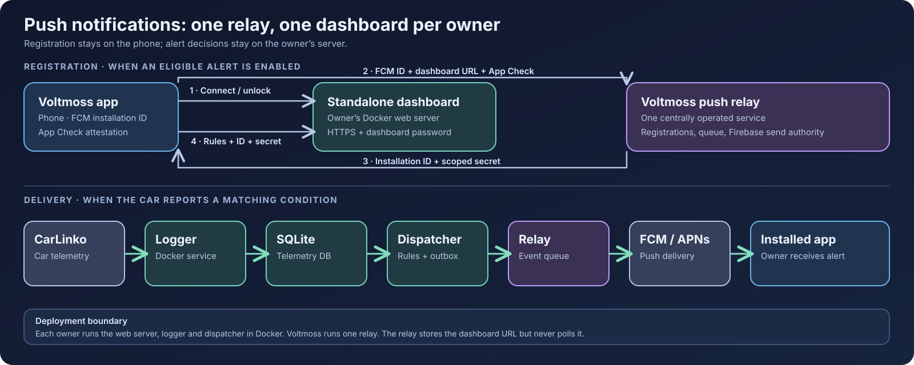

# J5 EV Dashboard

[English](README.md) · **Bahasa Indonesia** · [简体中文](README.zh-CN.md) · [Bahasa Melayu](README.ms.md)

Dashboard self-hosted untuk mobil CarLinko. Dashboard ini merekam telemetri yang sudah dikirim mobilmu dan menampilkan baterai, pengisian, perjalanan, ban, biaya, dan status kendaraan di browser. [App Voltmoss](https://github.com/anderscheow/j5_ev_app) terhubung ke dashboard tiap pemilik; setiap pemilik menjalankan instance sendiri.



Kredensial CarLinko dan telemetrimu disimpan di host milikmu sendiri. Kalau kamu mengaktifkan notifikasi push Voltmoss, dashboard-mu mendeteksi kondisi alert lalu mengirim event kecil ke relay yang dioperasikan secara terpusat. Relay mengirim notifikasi lewat Firebase dan tidak pernah polling dashboard-mu. Lihat [kontrak API dan push](docs/api-map.md).

## Fitur

- Status live baterai, jarak tempuh, pengisian, ban, dan aki 12 V.
- Sesi pengisian, efisiensi, perjalanan, riwayat, dan harga yang kamu atur sendiri.
- Perencana pengisian, peta charger, dan akses Home Assistant.
- Kontrol kendaraan (jika didukung). Ini perintah **nyata** ke mobil; [baca catatan kontrol](docs/control-opcodes.md) sebelum memakainya.

Coba tanpa akun: `docker compose run --rm -p 8088:8088 web python server.py --demo 8088`, lalu buka <http://localhost:8088>. Data contoh tidak pernah menghubungi mobil.

## Pasang dashboard sendiri dengan Docker

Kamu butuh Docker Compose, akun CarLinko yang punya akses ke mobilmu, dan host yang selalu menyala untuk mengumpulkan riwayat. Logger memakai sesi CarLinko yang aktif. Supaya app resmi tidak ter-logout, buat akun CarLinko kedua lalu authorise ke mobilmu lewat **Me → Authorisation → +** di akun utama.

1. Clone fork ini lalu jalankan web server dan logger:

   ```bash
   git clone https://github.com/anderscheow/j5-ev-dashboard.git
   cd j5-ev-dashboard
   docker compose up -d --build
   ```

2. Buka <http://localhost:8088>. Saat pertama kali, masukkan kredensial CarLinko di halaman login dashboard. Dashboard akan mendeteksi mobilmu dan menyimpan kredensial, token, dan telemetri di `./data`. Biarkan folder itu persisten dan privat.
3. Cek layanan dan log:

   ```bash
   docker compose ps
   docker compose logs --tail=80 web logger
   curl http://localhost:8088/api/status
   ```

Untuk akses dari luar rumah, pakai jaringan privat seperti Tailscale. Kalau dashboard akan punya URL publik, taruh di belakang HTTPS dan set **password dashboard** dari bagian Advanced di halaman login sebelum dibuka ke publik. App terhubung lewat URL HTTPS itu dan dibuka dengan password dashboard.

### Opsional: notifikasi push di Voltmoss

Push butuh URL HTTPS dashboard yang publik dan password dashboard. App dan dashboard sama-sama memakai relay Voltmoss yang tetap di `https://push-relay-production-149c.up.railway.app`; pemilik dashboard tidak perlu mengatur URL-nya atau punya kredensial Firebase. Taruh flag ini di file `.env` di samping `docker-compose.yml`:

```env
VOLTMOSS_PUSH_HTTPS=1
VOLTMOSS_PUSH_DISPATCHER=1
```

Jalankan satu dispatcher bersama web server dan logger:

```bash
docker compose --profile push up -d --build
docker compose ps
```

Hubungkan app ke URL HTTPS dashboard-mu, buka kuncinya, aktifkan minimal satu alert Plus yang memenuhi syarat, dan izinkan notifikasi. App mendaftarkan FCM installation ID dan URL dashboard ke relay, lalu mendaftarkan installation ID dari relay beserta secret terbatasnya ke dashboard-mu. Dispatcher mengevaluasi **telemetri yang sudah di-commit** dan mengirim event yang cocok ke relay. Cek respons publik `/api/status` untuk `push_alerts`; setelah dibuka, `/api/push/status` harus melaporkan `enabled: true`. Kalau salah satunya gagal, periksa `docker compose logs --tail=100 web push-dispatcher`.

## Update saat rilis dashboard terbit

Simpan `./data` dan `.env`; keduanya berisi state pemilik dan pengaturan push. Dari checkout dashboard:

```bash
git fetch origin --tags
git switch main
git pull --ff-only origin main
docker compose --profile push up -d --build   # pakai jika alert push aktif
docker compose ps
curl https://your-dashboard.example/api/status
```

Kalau push nonaktif, pakai `docker compose up -d --build`. Cek `docker compose logs --tail=100 web logger push-dispatcher` untuk error saat startup (hilangkan `push-dispatcher` jika nonaktif). Kalau kamu menjalankan rilis bertag, ganti baris `git switch main` dan `git pull` dengan `git switch --detach release-X.Y.Z` setelah fetch tag, lalu rebuild dengan perintah Compose yang sama. Jangan hapus `./data` saat update.

Rilis app memakai tag seperti `release-X.Y.Z+N`. Rilis sumber dashboard yang terkoordinasi memakai `release-X.Y.Z`, sesuai versi marketing **X.Y.Z** app; nomor build `+N` app tidak membuat tag dashboard baru. Build khusus app tidak butuh tag dashboard. `api_version` HTTP dan `capabilities` dashboard menjelaskan kompatibilitas klien secara terpisah dari tag Git. Maintainer: lihat [prosedur rilis](docs/releasing.md).

## Opsi instalasi lain

- Windows tanpa Docker: unduh ZIP repositori lalu jalankan `start.bat`.
- Linux systemd: `./tools/install.sh` memasang dashboard dan logger untuk user saat ini; `--tailscale` menambah akses jarak jauh privat.
- Python manual: pasang `requests` dan `websocket-client`, lalu jalankan `tools/setup.py`, `tools/logger.py --adaptive`, dan `tools/server.py 8088` dari folder `tools/`.
- Railway atau host satu container: pakai `bash railway_start.sh` sebagai start command layanan dan volume `/data` yang persisten. Lihat [catatan deployment](docs/ci-cd.md).

## Keamanan dan dokumentasi

Project ini mengakses **mobil dan akunmu sendiri** lewat API CarLinko yang tidak terdokumentasi. Tidak berafiliasi dengan Jaecoo, Chery, maupun CarLinko; perubahan dari vendor bisa merusaknya. Jangan jalankan satu dashboard sebagai layanan publik multi-user atau memasukkan kredensial pemilik lain ke dalamnya. Tiap pemilik sebaiknya men-deploy instance sendiri. Dashboard publik butuh HTTPS dan password. [SECURITY.md](SECURITY.md) berisi panduan keamanan lengkap.

[Fitur dan screenshot (EN)](docs/features.md) · [Opsi instalasi (EN)](docs/installation.md) · [Hosting, update, dan log (EN)](docs/operations.md) · [Legal dan privasi (EN)](docs/safety-privacy.md) · [Arsitektur (EN)](docs/architecture.md) · [Konfigurasi dan mobil yang dikenal](docs/id/configuration.md) · [Catatan akurasi](docs/id/accuracy.md) · [Peta API](docs/api-map.md) · [Home Assistant](docs/HOMEASSISTANT.md) · [Catatan produk](PRODUCT.md) · [Catatan desain](DESIGN.md) · [Lisensi](LICENSE)
