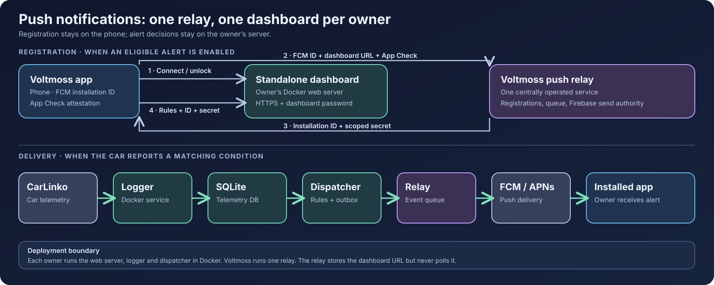

# J5 EV Dashboard

**English** · [Bahasa Indonesia](README.id.md) · [简体中文](README.zh-CN.md) · [Bahasa Melayu](README.ms.md)

A self-hosted dashboard for CarLinko cars. It records the telemetry your car already sends and shows battery, charging, trips, tyres, costs and vehicle status in a browser. The [Voltmoss app](https://github.com/anderscheow/j5_ev_app) connects to each owner's dashboard; each owner runs a separate instance.



The dashboard stores your CarLinko credentials and telemetry on your own host. If you enable Voltmoss push alerts, your dashboard detects alert conditions and sends small events to the centrally operated relay. The relay delivers notifications through Firebase; it never polls your dashboard. See [the API and push contract](docs/api-map.md).

## What it does

- Live battery, range, charging, tyre and 12 V status.
- Charge sessions, efficiency, trips, history and owner-set prices.
- Charge planning, a charger map and Home Assistant access.
- Vehicle controls where supported. These are real car commands; [read the control notes](docs/control-opcodes.md) before using them.

Try it without an account: `docker compose run --rm -p 8088:8088 web python server.py --demo 8088`, then open <http://localhost:8088>. The sample data never contacts a car.

## Set up your own dashboard with Docker

You need Docker Compose, a CarLinko account with access to your car, and a host that stays on to collect history. The logger uses a live CarLinko session. To avoid signing the official app out, create a second CarLinko account and authorise it for your car from **Me → Authorisation → +** in the primary account.

1. Clone this fork and start the web server and logger:

   ```bash
   git clone https://github.com/anderscheow/j5-ev-dashboard.git
   cd j5-ev-dashboard
   docker compose up -d --build
   ```

2. Open <http://localhost:8088>. On the first visit, enter your CarLinko credentials in the dashboard login page. It detects your car and saves credentials, tokens and telemetry in `./data`. Keep that directory persistent and private.
3. Check the services and logs:

   ```bash
   docker compose ps
   docker compose logs --tail=80 web logger
   curl http://localhost:8088/api/status
   ```

For access away from home, use a private network such as Tailscale. If the dashboard will have a public URL, put it behind HTTPS and set a **dashboard password** from the login page's Advanced section before exposing it. The app connects using that HTTPS URL and unlocks with the dashboard password.

### Optional: push alerts in Voltmoss

Push requires a public HTTPS dashboard URL and a dashboard password. The app and dashboard both use the fixed Voltmoss relay at `https://push-relay-production-149c.up.railway.app`; dashboard owners do not configure its URL or need Firebase credentials. Put these flags in a `.env` file beside `docker-compose.yml`:

```env
VOLTMOSS_PUSH_HTTPS=1
VOLTMOSS_PUSH_DISPATCHER=1
```

Start one dispatcher alongside the web server and logger:

```bash
docker compose --profile push up -d --build
docker compose ps
```

Connect the app to your dashboard's HTTPS URL, unlock it, enable at least one eligible Plus alert, and allow notifications. The app registers its FCM installation ID and dashboard URL with the relay, then registers the relay-issued installation ID and scoped secret with your dashboard. The dispatcher evaluates **committed telemetry** and sends matching events to the relay. Check the public `/api/status` response for `push_alerts`; after unlocking, `/api/push/status` should report `enabled: true`. If either check fails, inspect `docker compose logs --tail=100 web push-dispatcher`.

## Update when a dashboard release is published

Keep `./data` and `.env`; they hold the owner's state and push settings. From the dashboard checkout:

```bash
git fetch origin --tags
git switch main
git pull --ff-only origin main
docker compose --profile push up -d --build   # use if push alerts are enabled
docker compose ps
curl https://your-dashboard.example/api/status
```

If push is disabled, use `docker compose up -d --build` instead. Check `docker compose logs --tail=100 web logger push-dispatcher` for startup errors (omit `push-dispatcher` when disabled). If you run a tagged release, replace the `git switch main` and `git pull` lines with `git switch --detach release-X.Y.Z` after fetching tags, then rebuild with the same Compose command. Do not delete `./data` during an update.

App releases use tags such as `release-X.Y.Z+N`. A coordinated dashboard source release uses `release-X.Y.Z`, matching the app's **X.Y.Z** marketing version; the app's `+N` build number does not create another dashboard tag. An app-only build does not require a dashboard tag. The dashboard's HTTP `api_version` and advertised `capabilities` describe client compatibility independently of Git tags. Maintainers: see [release procedure](docs/releasing.md).

### Prompt for an AI setup or update agent

Copy this into an AI coding agent with access to **your dashboard checkout and Docker host**. Tell it whether this is a first setup or an update, and provide a target `release-X.Y.Z` tag if you use tagged releases:

```text
Set up or update my personal J5 EV Dashboard in this checkout. This is a
[first setup / update]. My target is [main / release-X.Y.Z].

Read README.md, docker-compose.yml, and the relevant installation and update
docs before changing anything. Inspect the current Git state and running
containers. Preserve local changes, ./data, and .env; never delete or replace
owner data. On updates, back up ./data and .env (if present) to a private
directory outside the checkout first, then fetch the target, rebuild, and
restart the existing Compose services.
If local changes block the update, explain the conflict before changing them.

For first setup, start the web and logger services and tell me where to open
the dashboard. Let me enter CarLinko credentials and set a dashboard password
in the dashboard UI; never ask me to paste secrets into chat or commit them.
If I want Voltmoss push alerts, first confirm my dashboard has a public HTTPS
URL and a dashboard password. Set VOLTMOSS_PUSH_HTTPS=1 and
VOLTMOSS_PUSH_DISPATCHER=1 in the private .env file, then start the Compose
push profile. The app and dashboard use the fixed relay at
https://push-relay-production-149c.up.railway.app; do not deploy a relay or
ask for Firebase credentials on this host.

Finish by checking docker compose ps, relevant service logs, and /api/status.
If push is enabled, also check that push_alerts is advertised and ask me to
unlock the dashboard in Voltmoss to confirm /api/push/status is enabled.
Report the version deployed, the dashboard URL, what you verified, and any
remaining step that needs my input. Do not print credentials or tokens.
```

## Account risk — read this first
This dashboard is **unofficial**: it talks to CarLinko's cloud the way the app does, but CarLinko
did not approve it. In November 2026 a user reported that the CarLinko account they ran the
dashboard on was **disabled** ("Your account has been disabled"). We don't know what triggered it.
Any account you log the dashboard into could be disabled the same way, so use it at your own risk.

What the dashboard does to keep its footprint small: one persistent socket instead of polling,
and a **login guard**: automatic re-logins are capped at 6 per hour, back off from 1 minute up to
30 minutes after a failure, and stop completely when CarLinko rejects the account (the dashboard
then shows a banner until you log in again by hand). Keep your install up to date. Older versions
could retry a failing login every few seconds.

## Head unit add-on: Climate Gesture
Set the fan and temperature from **anywhere on the head unit screen** with two fingers, without
opening the climate screen. Rest two fingers for about a third of a second, then slide:
sideways = fan (1 to 10), up/down = temperature (15.5 to 30.5 °C). A small card shows the value.
It starts by itself after every restart. Tested on a real Jaecoo J5 EV (head unit T13J-INTL
00.04.15, Android 12).

**Step-by-step guide with drawings is built into the dashboard:** run it on a laptop (Windows:
the `start` file, or `python tools/server.py`), log in, then **Account → Head unit add-ons**.
Only want the add-on? No CarLinko login needed: tap **Only want the head unit add-on?** on the
sign-in page, or open `/addons`.
About 10 minutes, parked, no cable. Short version:

1. **Engineering menu** — head unit *Settings → System → Version information*, tap *APP Version*
   10 times, type the **last 6 digits of the SOC Version** as the password.
2. **Enable ADB** — switch it on in Engineering mode. Touch nothing else there.
3. **Same hotspot** — phone hotspot on; head unit (*Connection → WiFi*) and laptop both join it.
4. **Find and install** — tap *Find head unit*, pick it, *Install*.
5. **Try it** — two fingers, hold, slide. Turn the head unit WiFi off again afterwards
   (wireless CarPlay / Android Auto don't work while it's on); the add-on keeps working.

No backup needed: it's an ordinary app install, no system files or car settings change. To undo,
open the Climate Gesture app and tap **Remove Climate Gesture**. Once installed, it closes ADB
over WiFi so nothing else on the network can reach the head unit. **Unofficial** — not from
Jaecoo or Chery; a head unit update may stop it. The installer checks the A/C first and refuses
a head unit it doesn't recognise. Source: [headunit/climate-gesture](headunit/climate-gesture),
APK: [headunit/dist](headunit/dist) (manual `adb` commands are on the add-ons page).

## Other installation options

- Windows without Docker: download the repository ZIP and run `start.bat`.
- Linux systemd: `./tools/install.sh` installs the dashboard and logger for the current user; `--tailscale` adds private remote access.
- Manual Python: install `requests` and `websocket-client`, then run `tools/setup.py`, `tools/logger.py --adaptive` and `tools/server.py 8088` from `tools/`.
- Railway or a single-container host: use `bash railway_start.sh` as the service start command and a persistent `/data` volume. See [deployment notes](docs/ci-cd.md). Details for every option: [install options](docs/installation.md) and [hosting](docs/operations.md).

## Safety and documentation

This project accesses **your own car and account** through an undocumented CarLinko API. It is unaffiliated with Jaecoo, Chery and CarLinko; vendor changes can break it. Do not run one dashboard as a public multi-user service or put other owners' credentials in it. Each owner should deploy their own instance. Public dashboards need HTTPS and a password. [Legal and privacy](docs/safety-privacy.md) and [SECURITY.md](SECURITY.md) have the full guidance.

[Features and screenshots](docs/features.md) · [Install options](docs/installation.md) · [Hosting, updates and logs](docs/operations.md) · [Legal and privacy](docs/safety-privacy.md) · [Architecture](docs/architecture.md) · [Configuration and known cars](docs/configuration.md) · [Accuracy notes](docs/accuracy.md) · [API map](docs/api-map.md) · [Home Assistant](docs/HOMEASSISTANT.md) · [Product notes](PRODUCT.md) · [Design notes](DESIGN.md) · [License](LICENSE)
