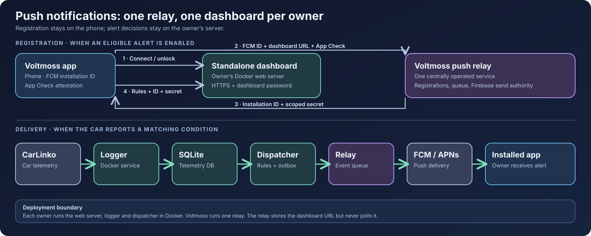

# J5 EV Dashboard

[English](README.md) · [Bahasa Indonesia](README.id.md) · [简体中文](README.zh-CN.md) · **Bahasa Melayu**

Dashboard layan diri (self-hosted) untuk kereta CarLinko. Ia merekod telemetri yang memang sudah dihantar kereta anda dan memaparkan bateri, pengecasan, perjalanan, tayar, kos dan status kenderaan dalam pelayar. [Aplikasi Voltmoss](https://github.com/anderscheow/j5_ev_app) bersambung ke dashboard setiap pemilik; setiap pemilik menjalankan instans sendiri.



Kelayakan CarLinko dan telemetri anda disimpan pada hos anda sendiri. Jika anda mengaktifkan makluman push Voltmoss, dashboard anda mengesan keadaan makluman dan menghantar peristiwa kecil kepada geganti (relay) yang dikendalikan secara berpusat. Geganti menghantar pemberitahuan melalui Firebase dan tidak pernah membuat polling pada dashboard anda. Lihat [kontrak API dan push](docs/api-map.md).

## Ciri-ciri

- Status langsung bateri, jarak boleh dipandu, pengecasan, tayar dan 12 V.
- Sesi cas, kecekapan, perjalanan, sejarah dan harga yang ditetapkan pemilik.
- Perancang cas, peta pengecas dan akses Home Assistant.
- Kawalan kenderaan (jika disokong). Ini ialah arahan **sebenar** kepada kereta; [baca nota kawalan](docs/control-opcodes.md) sebelum menggunakannya.

Cuba tanpa akaun: `docker compose run --rm -p 8088:8088 web python server.py --demo 8088`, kemudian buka <http://localhost:8088>. Data contoh tidak pernah menghubungi kereta.

## Sediakan dashboard sendiri dengan Docker

Anda memerlukan Docker Compose, akaun CarLinko yang mempunyai akses kepada kereta anda, dan hos yang sentiasa hidup untuk mengumpul sejarah. Logger menggunakan sesi CarLinko yang aktif. Untuk mengelakkan aplikasi rasmi daripada dilog keluar, buat akaun CarLinko kedua dan beri kebenaran (authorise) untuk kereta anda melalui **Me → Authorisation → +** dalam akaun utama.

1. Klon fork ini dan mulakan pelayan web serta logger:

   ```bash
   git clone https://github.com/anderscheow/j5-ev-dashboard.git
   cd j5-ev-dashboard
   docker compose up -d --build
   ```

2. Buka <http://localhost:8088>. Pada lawatan pertama, masukkan kelayakan CarLinko anda di halaman log masuk dashboard. Ia mengesan kereta anda dan menyimpan kelayakan, token dan telemetri dalam `./data`. Pastikan direktori itu kekal (persistent) dan peribadi.
3. Semak perkhidmatan dan log:

   ```bash
   docker compose ps
   docker compose logs --tail=80 web logger
   curl http://localhost:8088/api/status
   ```

Untuk akses semasa di luar rumah, gunakan rangkaian persendirian seperti Tailscale. Jika dashboard akan mempunyai URL awam, letakkan di belakang HTTPS dan tetapkan **kata laluan dashboard** daripada bahagian Advanced di halaman log masuk sebelum mendedahkannya. Aplikasi bersambung menggunakan URL HTTPS itu dan dibuka dengan kata laluan dashboard.

### Pilihan: makluman push dalam Voltmoss

Push memerlukan URL HTTPS dashboard yang awam dan kata laluan dashboard. Aplikasi dan dashboard kedua-duanya menggunakan geganti Voltmoss yang tetap di `https://push-relay-production-149c.up.railway.app`; pemilik dashboard tidak perlu menetapkan URL-nya atau mempunyai kelayakan Firebase. Letakkan bendera ini dalam fail `.env` di sebelah `docker-compose.yml`:

```env
VOLTMOSS_PUSH_HTTPS=1
VOLTMOSS_PUSH_DISPATCHER=1
```

Mulakan satu dispatcher bersama pelayan web dan logger:

```bash
docker compose --profile push up -d --build
docker compose ps
```

Sambungkan aplikasi ke URL HTTPS dashboard anda, buka kuncinya, aktifkan sekurang-kurangnya satu makluman Plus yang layak, dan benarkan pemberitahuan. Aplikasi mendaftarkan ID pemasangan FCM dan URL dashboard dengan geganti, kemudian mendaftarkan ID pemasangan yang dikeluarkan geganti serta rahsia berskop ke dashboard anda. Dispatcher menilai **telemetri yang telah di-commit** dan menghantar peristiwa yang sepadan kepada geganti. Semak respons awam `/api/status` untuk `push_alerts`; selepas dibuka, `/api/push/status` mesti melaporkan `enabled: true`. Jika mana-mana semakan gagal, periksa `docker compose logs --tail=100 web push-dispatcher`.

## Kemas kini apabila keluaran dashboard diterbitkan

Kekalkan `./data` dan `.env`; kedua-duanya menyimpan keadaan pemilik dan tetapan push. Daripada checkout dashboard:

```bash
git fetch origin --tags
git switch main
git pull --ff-only origin main
docker compose --profile push up -d --build   # guna jika makluman push diaktifkan
docker compose ps
curl https://your-dashboard.example/api/status
```

Jika push dinyahaktifkan, gunakan `docker compose up -d --build`. Semak `docker compose logs --tail=100 web logger push-dispatcher` untuk ralat permulaan (tinggalkan `push-dispatcher` jika dinyahaktifkan). Jika anda menjalankan keluaran bertag, gantikan baris `git switch main` dan `git pull` dengan `git switch --detach release-X.Y.Z` selepas mengambil tag, kemudian bina semula dengan arahan Compose yang sama. Jangan padam `./data` semasa kemas kini.

Keluaran aplikasi menggunakan tag seperti `release-X.Y.Z+N`. Keluaran sumber dashboard yang diselaraskan menggunakan `release-X.Y.Z`, sepadan dengan versi pemasaran **X.Y.Z** aplikasi; nombor binaan `+N` aplikasi tidak mencipta tag dashboard lain. Binaan khusus aplikasi tidak memerlukan tag dashboard. `api_version` HTTP dan `capabilities` dashboard menerangkan keserasian klien secara berasingan daripada tag Git. Penyelenggara: lihat [prosedur keluaran](docs/releasing.md).

## Pilihan pemasangan lain

- Windows tanpa Docker: muat turun ZIP repositori dan jalankan `start.bat`.
- Linux systemd: `./tools/install.sh` memasang dashboard dan logger untuk pengguna semasa; `--tailscale` menambah akses jauh persendirian.
- Python manual: pasang `requests` dan `websocket-client`, kemudian jalankan `tools/setup.py`, `tools/logger.py --adaptive` dan `tools/server.py 8088` dari dalam `tools/`.
- Railway atau hos satu kontena: gunakan `bash railway_start.sh` sebagai arahan mula perkhidmatan dan volum `/data` yang kekal. Lihat [nota penempatan](docs/ci-cd.md).

## Keselamatan dan dokumentasi

Projek ini mengakses **kereta dan akaun anda sendiri** melalui API CarLinko yang tidak didokumenkan. Ia tiada kaitan dengan Jaecoo, Chery dan CarLinko; perubahan vendor boleh merosakkannya. Jangan jalankan satu dashboard sebagai perkhidmatan awam berbilang pengguna atau letakkan kelayakan pemilik lain di dalamnya. Setiap pemilik patut menempatkan instans sendiri. Dashboard awam memerlukan HTTPS dan kata laluan. [SECURITY.md](SECURITY.md) mengandungi panduan keselamatan penuh.

[Ciri dan tangkapan skrin (EN)](docs/features.md) · [Pilihan pemasangan (EN)](docs/installation.md) · [Hos, kemas kini dan log (EN)](docs/operations.md) · [Undang-undang dan privasi (EN)](docs/safety-privacy.md) · [Seni bina (EN)](docs/architecture.md) · [Konfigurasi dan kereta yang dikenali](docs/ms/configuration.md) · [Nota ketepatan](docs/ms/accuracy.md) · [Peta API](docs/api-map.md) · [Home Assistant](docs/HOMEASSISTANT.md) · [Nota produk](PRODUCT.md) · [Nota reka bentuk](DESIGN.md) · [Lesen](LICENSE)
