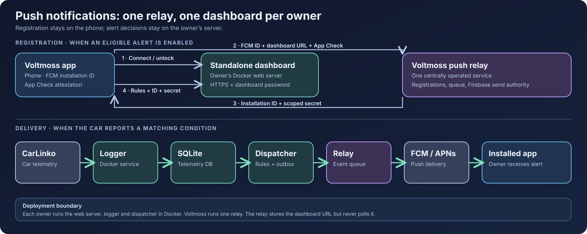

# J5 EV Dashboard

[English](README.md) · [Bahasa Indonesia](README.id.md) · **简体中文** · [Bahasa Melayu](README.ms.md)

面向 CarLinko 车辆的自托管仪表盘。它记录爱车本来就会发送的遥测数据，并在浏览器中显示电池、充电、行程、轮胎、费用和车辆状态。[Voltmoss 应用](https://github.com/anderscheow/j5_ev_app)会连接到每位车主自己的仪表盘；每位车主各自运行一个独立实例。



你的 CarLinko 凭据和遥测数据保存在你自己的主机上。如果启用 Voltmoss 推送提醒，你的仪表盘会检测提醒条件，并向集中运营的中继发送少量事件。中继通过 Firebase 投递通知，绝不会轮询你的仪表盘。详见 [API 与推送约定](docs/api-map.md)。

## 功能

- 实时显示电池、续航、充电、轮胎和 12 V 状态。
- 充电记录、能耗效率、行程、历史，以及车主自定义的价格。
- 充电规划、充电桩地图和 Home Assistant 接入。
- 车辆控制（在受支持的情况下）。这些是发给车辆的**真实指令**，使用前请先[阅读控制说明](docs/control-opcodes.md)。

无需账号即可试用：`docker compose run --rm -p 8088:8088 web python server.py --demo 8088`，然后打开 <http://localhost:8088>。示例数据不会连接任何车辆。

## 使用 Docker 搭建自己的仪表盘

你需要 Docker Compose、一个有权访问爱车的 CarLinko 账号，以及一台持续开机、用来收集历史数据的主机。日志记录器会占用一个 CarLinko 在线会话。为避免官方应用被登出，请另建一个 CarLinko 账号，并在主账号的 **Me → Authorisation → +** 中把它授权给你的车。

1. 克隆本 fork，并启动 Web 服务和日志记录器：

   ```bash
   git clone https://github.com/anderscheow/j5-ev-dashboard.git
   cd j5-ev-dashboard
   docker compose up -d --build
   ```

2. 打开 <http://localhost:8088>。首次访问时，在仪表盘登录页输入 CarLinko 凭据。它会识别你的车，并把凭据、令牌和遥测数据保存到 `./data`。请让该目录持久保存并保持私密。
3. 检查服务和日志：

   ```bash
   docker compose ps
   docker compose logs --tail=80 web logger
   curl http://localhost:8088/api/status
   ```

如需在外出时访问，请使用 Tailscale 等私有网络。如果仪表盘要有公网地址，请放在 HTTPS 之后，并在公开之前于登录页的 Advanced 部分设置**仪表盘密码**。应用通过该 HTTPS 地址连接，并用仪表盘密码解锁。

### 可选：Voltmoss 推送提醒

推送需要公网 HTTPS 仪表盘地址和仪表盘密码。应用和仪表盘都使用固定的 Voltmoss 中继 `https://push-relay-production-149c.up.railway.app`；仪表盘车主无需配置其地址，也不需要 Firebase 凭据。把以下标志写入 `docker-compose.yml` 旁的 `.env` 文件：

```env
VOLTMOSS_PUSH_HTTPS=1
VOLTMOSS_PUSH_DISPATCHER=1
```

在 Web 服务和日志记录器之外再启动一个调度器：

```bash
docker compose --profile push up -d --build
docker compose ps
```

让应用连接到你仪表盘的 HTTPS 地址并解锁，启用至少一项符合条件的 Plus 提醒，并允许通知。应用会先向中继注册其 FCM 安装 ID 和仪表盘地址，再把中继签发的安装 ID 和限定范围的密钥注册到你的仪表盘。调度器评估的是**已提交的遥测数据**，并把匹配的事件发送给中继。请检查公开的 `/api/status` 响应中的 `push_alerts`；解锁后，`/api/push/status` 应报告 `enabled: true`。如果任一项检查失败，请查看 `docker compose logs --tail=100 web push-dispatcher`。

## 仪表盘发布新版本时如何更新

请保留 `./data` 和 `.env`；它们保存车主的状态和推送设置。在仪表盘的检出目录中执行：

```bash
git fetch origin --tags
git switch main
git pull --ff-only origin main
docker compose --profile push up -d --build   # 已启用推送提醒时使用
docker compose ps
curl https://your-dashboard.example/api/status
```

如果未启用推送，请改用 `docker compose up -d --build`。查看 `docker compose logs --tail=100 web logger push-dispatcher` 以排查启动错误（未启用推送时去掉 `push-dispatcher`）。如果你运行的是带标签的发布版本，在获取标签后，用 `git switch --detach release-X.Y.Z` 替换 `git switch main` 和 `git pull` 两行，然后用相同的 Compose 命令重新构建。更新时请勿删除 `./data`。

应用发布使用 `release-X.Y.Z+N` 形式的标签。仪表盘的协同源码发布使用 `release-X.Y.Z`，与应用的 **X.Y.Z** 营销版本号一致；应用的 `+N` 构建号不会产生新的仪表盘标签。仅应用的构建不需要仪表盘标签。仪表盘的 HTTP `api_version` 和公布的 `capabilities` 独立于 Git 标签，用于描述客户端兼容性。维护者请见[发布流程](docs/releasing.md)。

## 其他安装方式

- 不使用 Docker 的 Windows：下载仓库 ZIP 并运行 `start.bat`。
- Linux systemd：`./tools/install.sh` 为当前用户安装仪表盘和日志记录器；`--tailscale` 增加私有远程访问。
- 手动 Python：安装 `requests` 和 `websocket-client`，然后在 `tools/` 目录中运行 `tools/setup.py`、`tools/logger.py --adaptive` 和 `tools/server.py 8088`。
- Railway 或单容器主机：使用 `bash railway_start.sh` 作为服务启动命令，并挂载持久的 `/data` 卷。详见[部署说明](docs/ci-cd.md)。

## 安全与文档

本项目通过未公开文档的 CarLinko API 访问**你自己的车辆和账号**。它与 Jaecoo、Chery 和 CarLinko 均无关联；厂商的改动可能导致它失效。请勿把一个仪表盘作为公开的多用户服务运行，也不要在其中放入其他车主的凭据。每位车主应部署自己的实例。公开的仪表盘需要 HTTPS 和密码。完整的安全指引见 [SECURITY.md](SECURITY.md)。

[功能与截图（英文）](docs/features.md) · [安装方式（英文）](docs/installation.md) · [托管、更新与日志（英文）](docs/operations.md) · [法律与隐私（英文）](docs/safety-privacy.md) · [架构（英文）](docs/architecture.md) · [配置与已知车型](docs/zh-CN/configuration.md) · [准确度说明](docs/zh-CN/accuracy.md) · [API 地图](docs/api-map.md) · [Home Assistant](docs/HOMEASSISTANT.md) · [产品说明](PRODUCT.md) · [设计说明](DESIGN.md) · [许可证](LICENSE)
